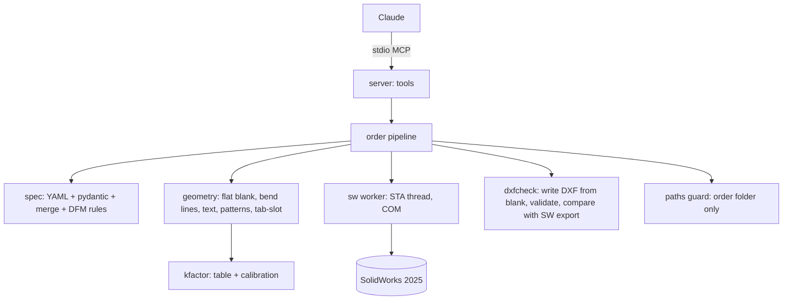

# MCP SolidWorks cho đèn decor tôn - Plan

## Goal Capsule

- **Objective:** Từ thông số một đơn đèn decor (kích thước, chữ/logo khắc, hoa văn), người dùng nhận được bộ file gia công sẵn gửi xưởng: DXF phẳng cắt laser và chấn ra đúng ±0.5 mm, cùng STL/3MF cho chi tiết in 3D, không phải tự dựng trên SolidWorks. Công cụ được công khai mã nguồn để maker trên makersg.com dùng lại.
- **Means:** Một MCP server mã nguồn mở, viết mới bằng Python, để Claude điều khiển SolidWorks 2025 qua COM theo kiểu "spec → dựng tất định" (Key Decisions).
- **Product authority:** Người dùng (chủ dự án đèn decor). Phạm vi đang làm chỉ gồm sheet metal + DXF + hiệu chỉnh K + xuất STL/3MF cho chi tiết in tham số. Dựng chi tiết in 3D từ đầu, lắp ráp và sửa model bất kỳ không thuộc phạm vi này.
- **Build mechanism:** Python tính bản phẳng chính xác, SolidWorks dựng base flange từ bản phẳng rồi gập bằng sketched bend (KTD1), chạy qua COM trên một luồng STA riêng (KTD2).
- **Open blockers:** Không có chặn khi triển khai. Muốn đạt tiêu chí ±0.5 mm cần gia công thật một thanh thử chữ L cho mỗi khoá hiệu chỉnh (F1). Việc này nằm ngoài phần mềm, không chặn việc merge.
- **Authority hierarchy:** Product Contract (R/F/AE) thắng về hành vi; KTD thắng về cơ chế trong phạm vi R; unit không ghi đè cả hai.
- **Execution profile:** Một nhánh, commit cục bộ trong repo `mcp-solidworks/` (chưa có remote nên không push, không PR). Test thuần Python chạy không cần SolidWorks; test có đánh dấu `sw` chạy trên SolidWorks 2025 SP5 thật của máy này.
- **Stop conditions:** Dừng và báo nếu U1 cho thấy SW 2025 không dựng được sketched bend trên base flange từ bản phẳng, hoặc không đặt được K qua API; khi đó KTD1 cần xem lại trước khi làm U5.
- **Who finishes:** `ce-work` triển khai toàn bộ U1–U10; người dùng tự gia công thanh thử và mẫu thật để xác nhận Success Criteria.

---

## Product Contract

### Summary

Claude viết một bản mô tả (spec) cho mẫu đèn tôn, sau đó ghép thêm thông số của từng đơn. MCP dựng part sheet metal trong SolidWorks đang chạy, áp hệ số K đã hiệu chỉnh, rồi xuất cho mỗi đơn một thư mục gồm DXF phẳng và STL/3MF. Hệ số K được hiệu chỉnh bằng thanh thử chữ L. Claude có thêm tool chụp màn hình và đo để tự kiểm tra kết quả.

### Problem Frame

Sản phẩm đèn decor khác biệt nhờ cá nhân hoá theo từng đơn và đóng gói phẳng (flat-pack). Vì vậy đơn nào cũng cần một bộ file gia công mới. Hiện người dùng tự dựng từng chi tiết tôn trên SolidWorks. Việc này chậm, nhất là khi ra biến thể. DXF gửi xưởng cũng hay lệch kích thước sau khi chấn, vì xưởng chưa cung cấp hệ số K.

Người dùng có máy in 3D. Cắt laser, chấn và sơn tĩnh điện thì thuê xưởng ngoài. Mỗi lần lệch kích thước là mất một vòng gia công thuê ngoài.

Các MCP SolidWorks mã nguồn mở hiện có (khoảng 180 repo) không có hệ số K hiệu chỉnh được, cũng không có khái niệm đơn hàng. Người dùng muốn công cụ này trở thành dự án mã nguồn mở của chính cộng đồng makersg.com.

### Key Decisions

- **Viết mới, không fork MCP có sẵn.** (session-settled: user-directed — chosen over fork soheil-mp/solidworks-mcp hoặc dùng nguyên: muốn phát triển mã nguồn mở riêng cho cộng đồng makersg.com.) Vẫn được tham khảo ý tưởng từ các repo MIT, có ghi công. Governs R17.
- **Spec → dựng tất định là cách điều khiển chính.** (session-settled: user-directed — chosen over bộ tool nhỏ sát API và tool chạy script tự do: kết quả phải tái lập được để đạt ±0.5 mm và để chia sẻ mẫu cho cộng đồng.) Governs R4, R8, R9, R10, R18.
- **Hiệu chỉnh K bằng thanh thử chữ L.** (session-settled: user-directed — chosen over xin K từ xưởng hoặc nới tiêu chí mẫu đầu lên ±1 mm: xưởng chưa có K mà vẫn cần ±0.5 mm.) Governs R11, R12.
- **Phục vụ máy người dùng trước, cộng đồng sau.** (session-settled: user-directed — chosen over hỗ trợ nhiều đời SW ngay bản 1 và trình cài một cú nhấp: cần một bản chạy chắc trước.) Governs R1, R17.
- **Sheet metal là năng lực ưu tiên; xuất STL/3MF đi kèm bản 1.** (session-settled: user-directed — chosen over chỉ sheet metal hoặc làm đủ bốn năng lực: phần tôn là thân đèn, còn xuất file in là việc nhỏ.) Governs R13, R14, R15.
- **Chi tiết in 3D là model tham số do người dùng dựng sẵn; MCP chỉ đổi biến theo đơn.** (session-settled: user-approved — chosen over để Claude dựng chi tiết in từ đầu ngay bản 1: giữ phạm vi bản 1 nhỏ mà vẫn ra đủ file cho mỗi đơn.) Governs R14.
- **Chữ cắt xuyên tấm phải giữ lõi.** (session-settled: user-approved — chosen over cắt chữ thẳng như font thường: các chữ O, A, D sẽ rơi mất lõi, đơn có chữ đầu tiên sẽ hỏng.) Governs R6.
- **Python, giấy phép MIT.** (session-settled: user-approved — chosen over C#/.NET: maker dễ đọc và đóng góp, máy đã có Python và uv.) Governs R17.

### Actors

- A1. Người dùng (chủ dự án): mô tả mẫu đèn và đơn hàng, đo thanh thử, gửi file cho xưởng.
- A2. Claude: viết spec, gọi MCP, tự kiểm tra kết quả qua ảnh chụp và số đo.
- A3. MCP server: dựng model trong SolidWorks và xuất file.
- A4. SolidWorks 2025 có license, đang chạy trên máy người dùng.
- A5. Xưởng ngoài: cắt laser, chấn, sơn tĩnh điện theo DXF.
- A6. Maker cộng đồng makersg.com: dùng lại công cụ và các spec được chia sẻ. Ở bản 1 chỉ cần đọc được README và mã.

### Requirements

**Nền tảng và kết nối**

- R1. MCP chạy cục bộ trên Windows và điều khiển SolidWorks 2025 đang chạy có license (cửa sổ có thể ẩn). Khi SW chưa chạy hoặc không có license, MCP báo lỗi rõ ràng thay vì treo.
- R2. Claude tự kiểm tra được kết quả: ảnh chụp view, lỗi và cảnh báo rebuild, kích thước bao của bản phẳng và của mô hình đã gập.
- R3. Khi chạy đơn, MCP chỉ ghi vào thư mục đầu ra của đơn hàng; ngoại lệ duy nhất là bảng K, do bước hiệu chỉnh (R12) ghi. Spec mẫu và model gốc của người dùng không bao giờ bị sửa.

**Spec mẫu đèn**

- R4. Spec mô tả một mẫu đèn gồm một hoặc nhiều chi tiết tôn: vật liệu, độ dày, biên dạng tấm, edge flange, hem, lỗ và cửa sổ.
- R5. Spec mô tả được hoa văn cắt: dạng lưới hoặc lục giác theo tham số, hoặc nhập hình 2D từ file DXF/SVG.
- R6. Spec khắc được chữ hoặc logo bằng đường cắt. Chữ có vòng kín vẫn giữ được lõi trên tấm (dùng font stencil hoặc cầu nối).
- R7. Spec tạo được khớp tab-slot giữa các tấm để lắp không cần hàn, với khe hở chỉnh được theo vật liệu và độ dày (kể cả lớp sơn tĩnh điện).
- R8. Spec tách phần mẫu dùng chung khỏi thông số đơn hàng (kích thước, chữ/logo, hoa văn). Một mẫu kết hợp thông số mới cho ra bộ file mới mà không sửa mẫu.
- R9. Dựng tất định: cùng spec và cùng bảng K thì ra cùng hình học DXF.
- R10. Spec là file văn bản, chia sẻ được. Người khác có SolidWorks tương thích dựng ra cùng kết quả.

**Hệ số K**

- R11. Khi dựng, MCP lấy K từ bảng theo khoá (xưởng, vật liệu, độ dày, độ mở cối V); xưởng và cối có giá trị mặc định. Nếu chưa có giá trị đã hiệu chỉnh, MCP dùng K mặc định và đánh dấu "chưa hiệu chỉnh" trên đầu ra của đơn.
- R12. MCP xuất DXF thanh thử chữ L cho một khoá hiệu chỉnh. Người dùng nhập số đo hai cạnh ngoài A, B sau khi chấn; MCP tính ngược K từ chiều dài phẳng thiết kế của thanh và lưu vào bảng.

**Đầu ra đơn hàng**

- R13. Mỗi đơn có một thư mục riêng. Trong đó mỗi chi tiết tôn có một DXF phẳng: đơn vị mm, tỉ lệ 1:1, đường cắt và đường chấn nằm ở hai layer khác nhau. Thư mục cũng chứa part SolidWorks đã dựng.
- R14. Với mỗi chi tiết in 3D có trong mẫu, MCP sao chép model tham số người dùng đã dựng, đổi các biến toàn cục theo đơn, rồi xuất STL/3MF vào thư mục đơn.
- R15. MCP xuất STL/3MF được cho bất kỳ part nào đang có, kể cả part tôn, khi được yêu cầu.
- R16. Mỗi đơn có một bản tóm tắt: danh sách file, vật liệu và độ dày, K đã dùng kèm trạng thái hiệu chỉnh, kích thước bao.

**Mã nguồn mở và an toàn**

- R17. Mã phát hành theo giấy phép MIT. README hướng dẫn maker cài trên Windows với SW 2025 và ghi rõ phiên bản SW đã kiểm.
- R18. Tool chạy script tự do có sẵn nhưng mặc định tắt. Chỉ bật khi người dùng chủ động đổi cấu hình.

### Key Flows

- F1. Hiệu chỉnh K
  - **Trigger:** Lần đầu dùng một cặp vật liệu/độ dày (ví dụ inox 0.8 mm), hoặc xưởng đổi dao chấn.
  - **Actors:** A1, A2, A3, A5
  - **Steps:** Claude yêu cầu thanh thử → MCP xuất DXF thanh chữ L → xưởng cắt và chấn → người dùng đo hai cạnh, báo cho Claude → MCP tính K và lưu vào bảng.
  - **Outcome:** Các đơn sau dùng vật liệu/độ dày đó được dựng với K đã hiệu chỉnh.
  - **Covered by:** R11, R12
- F2. Tạo mẫu đèn mới
  - **Trigger:** Người dùng mô tả bằng lời một mẫu đèn.
  - **Actors:** A1, A2, A3, A4
  - **Steps:** Claude viết spec → MCP dựng thử → Claude xem ảnh chụp, lỗi rebuild và số đo, sửa spec đến khi đạt → người dùng duyệt mẫu.
  - **Outcome:** Có một spec mẫu tái sử dụng được. Các chi tiết in đi kèm được tham chiếu tới model tham số của người dùng.
  - **Covered by:** R2, R4, R5, R6, R7, R9
- F3. Chạy một đơn hàng
  - **Trigger:** Có đơn mới với kích thước, chữ/logo và hoa văn riêng.
  - **Actors:** A1, A2, A3, A4
  - **Steps:** Claude ghép thông số đơn vào mẫu → MCP dựng chi tiết tôn, đổi biến các chi tiết in → xuất DXF và STL/3MF vào thư mục đơn → Claude kiểm tra kích thước bao và đọc bản tóm tắt.
  - **Outcome:** Thư mục đơn sẵn sàng gửi xưởng và đưa sang máy in.
  - **Covered by:** R3, R8, R13, R14, R16

### Acceptance Examples

- AE1. **Covers R11.** **Given** bảng chưa có K đã hiệu chỉnh cho nhôm 1.5 mm, **when** chạy một đơn dùng nhôm 1.5 mm, **then** đơn vẫn được xuất bằng K mặc định, và bản tóm tắt ghi rõ "chưa hiệu chỉnh".
- AE2. **Covers R6.** **Given** đơn khắc chữ "DOOR" cắt xuyên tấm, **when** xuất DXF, **then** lõi của D và hai chữ O vẫn nối với tấm, không thành mảnh rời.
- AE3. **Covers R1.** **Given** SolidWorks chưa mở, **when** Claude gọi dựng mẫu, **then** MCP trả lỗi nêu rõ SW chưa chạy, không treo và không ghi file dở.
- AE4. **Covers R3, R8.** **Given** một mẫu hộp 4 vách, **when** chạy hai đơn với kích thước 200 mm và 300 mm, **then** có hai thư mục đơn riêng, và spec mẫu cùng model chi tiết in gốc giữ nguyên.
- AE5. **Covers R12.** **Given** thanh thử inox 0.8 mm đã chấn, **when** người dùng nhập số đo hai cạnh, **then** MCP lưu một K mới cho inox 0.8 mm, và đơn tiếp theo dùng giá trị đó.

### Success Criteria

Người dùng mô tả bằng lời một chụp đèn tôn, ví dụ hộp 4 vách inox 0.8 mm có lỗ hoạ tiết, mép gập, khớp tab-slot và chữ khắc. Claude dựng và xuất DXF qua MCP với K đã hiệu chỉnh theo F1. Xưởng cắt và chấn từ đúng DXF đó, rồi đo được kích thước ngoài lệch không quá ±0.5 mm so với spec. Các tấm lắp được với nhau qua tab-slot mà không cần hàn.

### Scope Boundaries

**Deferred for later**

- Claude dựng chi tiết in 3D từ đầu (chụp khuếch tán, khớp nối). Bản 1 chỉ đổi biến của model người dùng dựng sẵn (R14).
- Tạo assembly đèn có mate để kiểm tra khớp.
- Đọc và sửa model SolidWorks bất kỳ, ngoài việc đổi biến toàn cục của model chi tiết in.
- Mặt cong, tôn côn, lofted bend, chấn nhiều bán kính khác nhau trên cùng chi tiết.
- Hỗ trợ SW khác 2025 và bản SOLIDWORKS for Makers. Chỉ làm khi có người trong cộng đồng báo lỗi.
- Trình cài một cú nhấp cho maker không biết lập trình.
- Tab gập và tab xoắn cho tab-slot; bản 1 chỉ có tab thẳng.
- Xếp hình tối ưu trên tấm (nesting), báo giá, bản vẽ 2D có kích thước.
- Đưa lên GitHub và giới thiệu trên makersg.com.

**Outside this product's identity**

- Slicing và gửi lệnh in: việc của slicer và các công cụ in riêng, không phải của MCP này.
- CAD khác SolidWorks, macOS và Linux.

<!-- ce-section: work-relationships -->
### How This Work Fits Together

Kế hoạch này chỉ lo bản 1 của MCP: sheet metal, DXF, hiệu chỉnh K và xuất STL/3MF cho chi tiết in tham số. Phân chia dưới đây là cách hiểu hiện tại, chưa phải lộ trình đã cam kết.

- Kiểm chứng thị trường đèn decor (`2026-11-21-0910-den-decor-kiem-chung-thi-truong-plan.md` ở thư mục cha của repo này, ngoài git)
  - Enables: các quyết định cá nhân hoá theo đơn, flat-pack và chi tiết in bắt buộc trong kế hoạch này.
  - Can proceed independently of: việc xây MCP.
- Claude dựng chi tiết in 3D từ đầu
  - Depends on: phần nền kết nối và kiểm tra (R1, R2) của kế hoạch này.
  - Still to decide: có thay cho model tham số người dùng tự dựng (R14) hay không.
- Lắp ráp đèn và đọc/sửa model có sẵn
  - Shares: cùng phần nền kết nối SolidWorks.
  - Still to decide: thứ tự ưu tiên giữa hai việc.

### Dependencies / Assumptions

- Máy có SolidWorks 2025 SP5, license desktop, COM `SldWorks.Application.33` đã đăng ký, có interop DLL trong thư mục cài (đã kiểm trên máy).
- Python 3.11 và uv có sẵn. pywin32 chưa cài. Không có .NET SDK (đã kiểm trên máy).
- Theo các tài liệu đã tìm (chưa thử trên SW 2025): SolidWorks API xuất được flat pattern ra DXF trực tiếp từ part, không cần bản vẽ, và đặt được K qua custom bend allowance.
- Tiêu chí ±0.5 mm áp cho kích thước ngoài đi qua tối đa 2 nếp gập, đo tại nếp gập (không đo ở mép flange). Sai số góc chấn ±1° trên flange 50 mm đã làm mép lệch khoảng 0.87 mm, và dung sai thông dụng qua 3 nếp gập trở lên là ±0.76 mm. Kích thước ngoài của hộp 4 vách trong Success Criteria đi qua đúng 2 nếp gập nên vẫn nằm trong giới hạn.
- Lớp sơn tĩnh điện làm dày tấm, ảnh hưởng tới khe hở tab-slot. Khe hở chỉnh được (R7) là để bù phần này.

### Outstanding Questions

Các câu hỏi để lại cho khâu lập kế hoạch đã được trả lời trong Planning Contract: định dạng spec (KTD4), cách gọi COM (KTD2), giữ lõi chữ (KTD7), thanh thử và khoá bảng K (KTD5), layer DXF (KTD6), tab-slot mặc định (KTD8), quy ước biến của chi tiết in (KTD9). Các câu hỏi còn lại nằm ở Planning Contract → Open Questions.

**Product Contract preservation:** changed: R3 — nói rõ R3 áp cho lúc chạy đơn và bảng K là ngoại lệ, vì R12 vốn yêu cầu lưu K vào bảng; R12 — gọi tên hai số đo A, B. Changed: R11 — khoá bảng K mở rộng từ (vật liệu, độ dày) thành (xưởng, vật liệu, độ dày, độ mở cối V), xưởng và V có giá trị mặc định. Lý do: trong chấn gió, bán kính trong phụ thuộc vào cối chứ không vào độ dày, nên một K cho mỗi vật liệu/độ dày chỉ đúng khi xưởng luôn dùng một cối. Mọi R/F/AE khác giữ nguyên.

### Sources / Research

- Khảo sát MCP SolidWorks mã nguồn mở (2026-11-21, đọc README, chưa chạy thử):
  - `soheil-mp/solidworks-mcp` (C#, MIT, đã thử trên SW 2025): tham khảo cách đặt tên tool sheet metal và cách xuất 3MF.
  - `aryesil/SolidworksMCP`: tham khảo cách đọc K và xuất flat pattern.
  - `hjbaard/SolidWorks-MCP`: tham khảo lớp COM Python dùng makepy và một luồng STA.
  - `eyfel/mcp-server-solidworks` dùng giấy phép AGPL, không nên mượn mã.
- Bẫy COM khi gọi từ Python ngoài tiến trình: tham số out cần VARIANT byref, Callout null trong `SelectByID2`, mảng VARIANT, phân biệt method và property khi late binding.
- API cần thử trên SW 2025:
  - `IPartDoc.ExportToDWG2` với `swExportToDWG_ExportSheetMetal` để xuất flat pattern.
  - `CustomBendAllowance` (Type = K-factor, `KFactor`, `SetCustomBendAllowance`, `ModifyDefinition`) để đặt K.
- Ghi chú từ phiên kiểm chứng thị trường (2026-11-21): cá nhân hoá theo đơn, flat-pack, chi tiết in bắt buộc. Người dùng có máy in 3D; cắt laser, chấn và sơn tĩnh điện thuê xưởng ngoài.
- Quy tắc gia công (Protolabs, Hubs, SendCutSend, TheFabricator; skill cục bộ `dfm`, `dxf`, `sendcutsend`): công thức BA/BD, bán kính trong khi chấn gió ≈ p·V, dung sai qua nếp gập, khe hở tab-slot có sơn tĩnh điện, quy ước DXF. Số liệu dùng làm mặc định nằm ở KTD5–KTD8.
- API SolidWorks 2025 SP5 (kiểm trong file trợ giúp API cài trên máy): tạo feature sheet metal qua `FeatureManager.CreateDefinition` + `CreateFeature` (`swFmBaseFlange`, `swFmSketchBend`, `swFmNormalCut`); K qua `CreateCustomBendAllowance`; `InsertSheetMetalBaseFlange2`, `InsertSheetMetalEdgeFlange2`, `FeatureLinearPattern5`, `FeatureFillPattern` đã lỗi thời. Type library `sldworks.tlb` và `swconst.tlb` nằm ở thư mục cài SW. API không nhập SVG; cắt chữ xuyên tấm làm rơi lõi; từ SW 2022 không có layer BEND mặc định khi xuất DXF.
- SDK MCP Python: gói `mcp` 2.x, lớp `MCPServer` trong `mcp.server.mcpserver`, `run(transport="stdio")`; `FastMCP` của v1 không còn.

---

## Planning Contract

### Key Technical Decisions

- KTD1. **Dựng theo bản phẳng (flat-first).** Python tính toàn bộ bản phẳng: biên dạng, relief, lỗ, hoa văn, chữ, tab-slot, và vị trí đường gập theo K và R của khoá hiệu chỉnh. SolidWorks dựng base flange từ biên dạng đó (một sketch chứa biên ngoài và mọi lỗ) rồi gập bằng sketched bend dọc các đường gập, tất cả qua `CreateDefinition` + `CreateFeature`. Cách ngược lại (dựng hộp bằng edge flange rồi cắt trên từng mặt) buộc phải chọn mặt/cạnh qua COM, vốn dễ vỡ, và SW không tự thêm cầu cho chữ cắt xuyên. Flat-first đưa mọi phép tính 2D vào mã Python test được, và cho phép đối chiếu bản phẳng SW xuất ra với bản phẳng dự đoán. Quy ước: mỗi đường gập U4 xuất ra là đường tâm của vùng bend allowance, và U5 tạo sketched bend với PositionType = bend centerline. Hem (open) cũng là một dải trong bản phẳng cộng một đường gập 180°, gập bằng sketched bend như mọi nếp khác. Thứ tự gập và cách đặt đường gập cho nếp gập nối tiếp (mép gập trên vách đã dựng) do spike U1 quyết định và ghi lại ở đây. Governs R4, R5, R6, R7, R9.
- KTD2. **Python 3.11 + pywin32, early binding bằng makepy cho `sldworks.tlb`/`swconst.tlb`, gắn vào SW đang chạy bằng `GetActiveObject`, mọi lời gọi COM chạy trên một luồng STA riêng.** Handler của MCP gửi việc vào hàng đợi của luồng đó và chờ kết quả. Early binding tránh phần lớn bẫy late binding (tham số out, method/property); `GetActiveObject` tránh vô tình mở một SW ẩn. Việc sinh wrapper makepy chuyển stdout sang stderr để không làm hỏng luồng stdio của MCP, và có lệnh `swlamp-mcp --prepare` để sinh sẵn lúc cài. Một lời gọi COM bị kẹt (thường do hộp thoại modal) không huỷ được: khi quá hạn, worker đánh dấu luồng là kẹt, các việc sau trả lỗi ngay "SolidWorks đang bận hoặc đang mở hộp thoại", và một luồng STA mới chỉ được dựng lại khi lời gọi thăm dò thành công. Trong lúc chạy, worker đặt và sau đó khôi phục các tuỳ chọn tắt hộp thoại (`swDXFDontShowMap`, `swSTLShowInfoOnSave`, `sw3MFShowInfoOnSave`, `swSTLPreview`), gọi `ShowFeatureErrorDialog(False)`, và mở/lưu với tuỳ chọn Silent. Cites R1, R17. (session-settled: user-approved — chosen over C#/.NET: maker dễ đọc và đóng góp, máy đã có Python và uv.)
- KTD3. **MCP server dùng SDK `mcp` 2.x (`MCPServer`), stdio, chạy bằng `uv run`.** Đây là cách Claude Code và Claude Desktop đăng ký server cục bộ trên Windows; ảnh chụp trả về dạng `Image`.
- KTD4. **Spec là YAML, kiểm bằng pydantic, đơn vị mm.** File mẫu (template) mô tả các tấm, vật liệu, độ dày, nếp gập, hoa văn, chữ, tab-slot và các tham số có tên. File đơn (order) chỉ ghi đè tham số có tên, chữ/logo, hoa văn. YAML dễ đọc và dễ đăng lên diễn đàn. Governs R8, R10.
- KTD5. **Bảng K là file JSON trong thư mục cấu hình người dùng, không nằm trong repo.** Khoá theo R11. Mỗi dòng lưu cặp (K, R giả định), BD đo được, trạng thái `calibrated`/`provisional` và ngày. K tạm theo R/T khi chấn gió: R/T < 1 → 0.38, 1–3 → 0.42, > 3 → 0.50; không dùng 0.5 mặc định của SW cho tôn mỏng. R giả định ≈ p·V với p = 0.21 (inox), 0.16 (thép), 0.12 (nhôm); chưa biết cối thì V ≈ 6·T. Tính ngược từ thanh chữ L: K = (2·(L − A − B + 2R + 2T)/π − R)/T, với L là chiều dài phẳng thiết kế của thanh (lấy từ hình học thanh thử), A, B là hai cạnh ngoài đo sau khi chấn. Giá trị hiệu chỉnh chỉ có giá trị cho nếp 90°; nếp ở góc khác và hem luôn bị ghi "chưa hiệu chỉnh" trong tóm tắt đơn. K tính ra nằm ngoài 0.25–0.55 không bị từ chối mà kèm cảnh báo rằng R giả định (cối V) có thể sai, đề nghị nhập V thật trước khi lưu. Governs R11, R12.
- KTD6. **DXF giao xưởng được ghi thẳng từ bản phẳng của U4 bằng `ezdxf`; DXF SolidWorks xuất bằng `ExportToDWG2` chỉ dùng để đối chiếu.** File giao: layer `CUT`, `BEND_UP`, `BEND_DOWN` gán ngay lúc ghi theo dữ liệu dự đoán; `$INSUNITS = 4`; chỉ LINE/ARC/CIRCLE/LWPOLYLINE; R2000; không bù kerf. Trước khi giao, file được kiểm: đường cắt khép kín, không trùng, đường gập phủ hết chiều dài nếp gập. Đối chiếu chỉ bảo đảm SW dựng đúng hình đã gửi: các đường cắt trong DXF của SW phải khớp file giao trong 0.05 mm (không dùng `GetPartBox` vì chỉ gần đúng). Kích thước đúng hay sai do cổng kiểm dạng gập ở U8 bảo đảm, không do phép đối chiếu này. Kiểm trượt thì đơn báo lỗi và không có DXF nào trong thư mục đơn. Governs R9, R13.
- KTD7. **Chữ/logo: đường viền glyph lấy bằng `fontTools`, hình học xử lý bằng `shapely`, tự sinh cầu cho mọi đảo.** Mỗi vùng kín bên trong (lõi O, A, D, logo) được nối với tấm bằng cầu rộng ≥ max(1·T, 0.8 mm). Nét và lỗ nhỏ hơn 1·T bị từ chối, kèm cỡ chữ tối thiểu. Font stencil có sẵn cũng dùng được. Artwork DXF đọc bằng `ezdxf`, SVG đọc bằng `svgelements`, cả hai đổi thành polygon trong Python. Governs R5, R6.
- KTD8. **Tab-slot vẽ trực tiếp trong bản phẳng, dạng tab thẳng.** Không dùng feature Tab and Slot của SW (cần chọn nhiều đối tượng). Rộng tab ≥ max(2T, 3.2 mm). Khe = tab + 0.25 mm + 4 × độ dày sơn (tham số, mặc định 80 µm mỗi mặt). Lỗ và khe cách đường gập ≥ 2T + R. Bản 1 không có tab xoắn vì dễ nứt inox 0.8 mm và lớp sơn. Hem mặc định là open hem, nằm trong bản phẳng theo KTD1; chỉ khi spike U1 cho thấy sketched bend không gập được tới 180° mới dùng `InsertSheetMetalHem2`, và khi đó U4 cộng chiều dài khai triển của hem vào bản phẳng dự đoán. Hem kín bị từ chối kèm cảnh báo cần xưởng xác nhận. Governs R4, R7.
- KTD9. **Chi tiết in khai báo kích thước điều khiển bằng biến toàn cục (Equations) có tiền tố `ord_`.** MCP sao chép file vào thư mục đơn với tên riêng theo đơn (`<tên>__<order_id>.SLDPRT`), từ chối nếu model dùng equations liên kết file ngoài, chỉ đổi các biến `ord_*` có trong đơn, rebuild, rồi xuất 3MF (mặc định) và STL qua `Extension.SaveAs3`. Biến không có tiền tố không bao giờ bị đổi. Biến đơn yêu cầu mà model không có thì báo lỗi. Governs R14, R15.
- KTD10. **Mọi lần ghi đi qua một bộ bảo vệ đường dẫn, và mọi tài liệu SW mà pipeline mở đều được đóng khi đơn kết thúc.** Khi chạy đơn, đường ghi phải nằm trong thư mục đơn; riêng `calibration_record` chỉ được ghi file bảng K. Mọi part dựng hoặc sao chép mang tên riêng theo đơn. Trước khi mở một file, worker kiểm tiêu đề các tài liệu đang mở trong SW và từ chối nếu trùng, vì SW không mở được hai tài liệu cùng tên và sẽ trả về bản gốc đang mở. Sau khi mở, đường dẫn tài liệu phải trùng đường dẫn bản sao. Đơn thành công hay lỗi đều `CloseDoc` mọi tài liệu đã mở. Governs R3.
- KTD11. **Tool chạy script tự do chỉ đăng ký khi biến môi trường `SWLAMP_ENABLE_SCRIPT=1`.** Mặc định tool không có trong danh sách. Governs R18.

### High-Level Technical Design

Các thành phần và hướng phụ thuộc. Lõi Python thuần (spec, geometry, kfactor, dxfcheck) không import COM, nên chạy test được mà không cần SolidWorks.



Luồng chạy một đơn (F3):

```mermaid
sequenceDiagram
  participant C as Claude
  participant S as server
  participant O as order
  participant G as geometry
  participant W as sw worker
  participant X as dxfcheck
  C->>S: run_order(template, order)
  S->>O: merge + validate spec
  O->>G: flat blank + bend lines (K, R from table)
  O->>W: base flange from blank, sketched bends, K/R, rebuild
  W-->>O: rebuild errors, folded bbox
  O->>O: gate: folded bbox vs spec outer dims (0.05 mm)
  O->>W: SW flat export (check only), 3MF/STL; printed parts: copy, set ord_*, export
  O->>X: write DXF from blank, validate, compare with SW export
  O->>W: close every opened document
  O-->>S: summary (files, K status, bbox, warnings)
  S-->>C: summary + screenshot
```

Trạng thái một khoá K: `missing` → (dùng K tạm) `provisional` → (nhập số đo thanh thử) `calibrated` → (nhập số đo mới) `calibrated` với giá trị mới. Đơn dùng khoá chưa `calibrated` luôn mang cờ trong tóm tắt (R11, AE1).

### Output Structure

```text
mcp-solidworks/
  pyproject.toml
  LICENSE
  README.md
  docs/          spec-format.md, calibration.md, plans/
  src/swlamp/
    server.py, config.py, paths.py
    spec/        models.py, merge.py, rules.py
    geometry/    blank.py, bends.py, patterns.py, text.py, tabslot.py, artwork.py
    kfactor/     table.py, calibrate.py
    sw/          worker.py, connection.py, builder.py, export.py, inspect.py, equations.py
    dxfcheck/    write.py, validate.py, compare.py
    order/       pipeline.py, summary.py
  examples/      box4-inox08.template.yaml, order-200.yaml, order-300.yaml
  tests/         unit tests per package; tests/sw/ live SolidWorks tests
```

### Assumptions

- Hem trong spec là open hem; hem kín bị từ chối vì nhiều xưởng chỉ chấn tới 120–130° và hem kín giữ hoá chất tiền xử lý sơn (KTD8).
- Xưởng và cối mặc định là `default`; người dùng ghi tên xưởng và V khi biết (KTD5).
- Mọi nếp gập trong một chi tiết dùng chung một bán kính.
- SW 2025 đang mở sẵn khi Claude gọi tool; MCP không tự khởi động SW.

### Open Questions

**Deferred to Implementation**

- Sketched bend qua `CreateDefinition(swFmSketchBend)`, K đặt khi tạo base flange, sketched bend tới 180° cho hem, và cách đặt đường gập cho nếp gập nối tiếp: U1 kiểm trên máy và ghi kết quả vào KTD1.
- `ExportToDWG2` cần options nào để có đủ đường cắt cho phép đối chiếu của KTD6.
- Font mặc định để khắc chữ trên Windows và cách đóng gói một font stencil có giấy phép mở.

**Cần người dùng quyết định (không chặn triển khai)**

- Dung sai cho kích thước đi qua 3 nếp gập trở lên, và cho mép flange. Tiêu chí ±0.5 mm hiện chỉ đúng cho kích thước ngoài qua tối đa 2 nếp gập, đo tại nếp gập (Dependencies / Assumptions). Nếu muốn giữ ±0.5 mm mọi nơi thì phải giới hạn số nếp gập trong spec; nếu chấp nhận ±0.76 mm qua 3+ nếp thì tóm tắt đơn chỉ cần ghi chú. Triển khai mặc định theo hướng thứ hai: tóm tắt cảnh báo các kích thước đi qua 3+ nếp gập.

### Risks

- Sketched bend qua đường gập cắt ngang lỗ có thể rebuild lỗi. Giảm rủi ro: luật DFM cấm lỗ trong dải 2T + R quanh đường gập (KTD8), và U1 thử trường hợp có lỗ gần đường gập.
- Hộp thoại modal của SW làm treo luồng COM. Giảm rủi ro theo KTD2: tắt hộp thoại khi chạy, đánh dấu luồng kẹt, các việc sau báo lỗi ngay, chỉ dựng lại luồng khi thăm dò thành công.
- Bản phẳng SW lệch bản phẳng dự đoán (do SW làm tròn relief hay góc). Phép đối chiếu của KTD6 bắt được, và đơn báo lỗi thay vì giao file sai.
- Sai số góc chấn ±1° làm mép trên vách 80 mm lệch khoảng 1.4 mm, nên tab ở mép vách có thể không vào khe nếu vách không đàn hồi về. Phần mềm không kiểm được điều này; mẫu thật đầu tiên sẽ cho biết có cần đặt tab gần nếp gập hơn hay không.
- SDK MCP 2.x còn mới, API có thể đổi. Giảm rủi ro: ghim phiên bản trong `pyproject.toml`.

---

## Implementation Units

### U1. Khung dự án và kết nối SolidWorks

**Goal:** Dựng dự án uv, kết nối SW 2025 qua COM trên một luồng STA, và kiểm sống các API mà KTD1 phụ thuộc.

**Requirements:** R1, R17; AE3; KTD2, KTD3.

**Dependencies:** none.

**Files:** `pyproject.toml`, `.gitignore`, `src/swlamp/__init__.py`, `src/swlamp/config.py`, `src/swlamp/sw/worker.py`, `src/swlamp/sw/connection.py`, `tests/conftest.py`, `tests/test_worker.py`, `tests/sw/test_connection.py`, `tests/sw/test_api_spike.py`.

**Approach:**
1. Dự án uv, ghim `mcp` 2.x, `pywin32`, `pydantic`, `pyyaml`, `shapely`, `ezdxf`, `fontTools`, `svgelements`; dev: `pytest`, `ruff`. Marker pytest `sw`; `conftest.py` skip test `sw` khi không gắn được vào SW.
2. Worker theo KTD2: một luồng gọi `CoInitialize` (STA), nhận việc qua hàng đợi, có timeout; quá hạn thì đánh dấu kẹt, báo lỗi ngay cho các việc sau, dựng luồng mới khi thăm dò thành công.
3. Kết nối: `GetActiveObject("SldWorks.Application")`, sinh early binding cho hai type library với stdout chuyển sang stderr; không có SW thì báo lỗi rõ, không tự mở. Đặt và khôi phục các tuỳ chọn tắt hộp thoại theo KTD2.
4. Spike sống trên SW 2025, ghi kết quả vào KTD1 và docstring của `connection.py`:
   - bản phẳng hình chữ thập có relief góc, base flange đặt K qua custom bend allowance, đọc lại K;
   - bốn sketched bend với PositionType = bend centerline, kiểm vị trí vách khớp dự đoán;
   - một mép gập nối tiếp trên một vách (quyết định thứ tự gập và cách đặt đường gập);
   - một open hem bằng sketched bend 180° (nếu không được thì thử `InsertSheetMetalHem2`);
   - xuất flat DXF bằng `ExportToDWG2`;
   - chụp ảnh khi cửa sổ SW thu nhỏ.

**Execution note:** Làm spike sống trên SW 2025 trước mọi unit khác; nếu sketched bend hoặc đặt K không làm được, dừng theo Stop conditions.

**Test scenarios:**
- Worker chạy một hàm trên luồng STA và trả kết quả cho lời gọi.
- Một việc không bao giờ trả về: worker báo timeout, việc tiếp theo nhận lỗi "SolidWorks đang bận" ngay chứ không chờ hết timeout.
- Sau khi luồng kẹt, lời gọi thăm dò thành công thì worker dựng luồng mới và nhận việc bình thường.
- Sinh wrapper makepy không ghi gì ra stdout.
- Covers AE3. Không có SW đang chạy: `connect` trả lỗi có thông điệp "SolidWorks chưa chạy", không treo, không ghi file.
- (sw) Gắn vào SW đang chạy, đọc ra phiên bản bắt đầu bằng 33 (SW 2025).
- (sw) Spike: hộp chữ thập inox 0.8, K = 0.42, bốn nếp gập, một mép gập nối tiếp và một open hem dựng không lỗi; đọc lại K = 0.42; xuất được DXF; ảnh chụp khác rỗng.

**Verification:** Test thuần xanh khi không có SW; test `sw` xanh khi SW 2025 đang chạy.

### U2. Spec: mô hình, gộp mẫu với đơn, luật DFM

**Goal:** Đọc YAML mẫu và đơn, gộp thành spec đầy đủ, kiểm luật gia công trước khi dựng.

**Requirements:** R4, R5, R6, R7, R8, R10; AE4; KTD4, KTD8.

**Dependencies:** U1.

**Files:** `src/swlamp/spec/models.py`, `src/swlamp/spec/merge.py`, `src/swlamp/spec/rules.py`, `tests/spec/test_models.py`, `tests/spec/test_merge.py`, `tests/spec/test_rules.py`, `examples/box4-inox08.template.yaml`, `examples/order-200.yaml`, `examples/order-300.yaml`.

**Approach:**
1. Mô hình template: vật liệu, độ dày, xưởng, cối, các tấm, nếp gập theo cạnh, hem, lỗ, hoa văn, chữ, artwork, tab-slot, tham số có tên, các chi tiết in kèm biến `ord_*`. Mô hình order: giá trị tham số, chữ, hoa văn, artwork.
2. Gộp: order chỉ ghi đè tham số đã khai báo; khoá lạ bị từ chối.
3. Luật: flange ≥ max(4T, V/2 + T + R); lỗ, hoa văn, khe cách đường gập ≥ 2T + R; nét, lỗ, cầu ≥ 1·T; hem kín bị từ chối.

**Test scenarios:**
- Mẫu hộp 4 vách hợp lệ nạp được và có đủ 4 nếp gập.
- Covers AE4. Gộp order 200 và order 300 ra hai spec khác kích thước; đối tượng template không đổi.
- Order ghi đè tham số không khai báo: báo lỗi nêu tên tham số.
- Flange 2 mm trên inox 0.8 bị từ chối, thông báo nêu giá trị tối thiểu.
- Hoa văn chạm dải cấm quanh đường gập bị từ chối.
- Hem kín bị từ chối kèm thông báo cần xưởng xác nhận.

**Verification:** Test spec xanh; các file trong `examples/` qua kiểm.

### U3. Bảng K và hiệu chỉnh

**Goal:** Lưu, tra và hiệu chỉnh K theo khoá; sinh hình học thanh thử chữ L.

**Requirements:** R11, R12; F1; AE1, AE5; KTD5.

**Dependencies:** U1.

**Files:** `src/swlamp/kfactor/table.py`, `src/swlamp/kfactor/calibrate.py`, `tests/kfactor/test_table.py`, `tests/kfactor/test_calibrate.py`.

**Approach:**
1. Bảng JSON ở thư mục cấu hình người dùng (đổi được qua biến môi trường để test dùng thư mục tạm); ghi nguyên tử bằng file tạm rồi đổi tên.
2. Tra khoá: có `calibrated` thì dùng cho nếp 90°; không có thì trả K tạm theo KTD5, trạng thái `provisional`. Nếp góc khác và hem luôn mang trạng thái chưa hiệu chỉnh.
3. Thanh thử: rộng 100 mm, hai cánh 40 mm, mã nhận dạng (vật liệu, T, K tạm) cắt nhỏ ở góc, xa đường gập.
4. Người dùng nhập A, B; L lấy từ hình học thanh thử đã xuất. Tính K theo KTD5; nhiều mẫu thì lấy trung bình và trả độ lệch; lưu cùng R giả định và BD đo.

**Test scenarios:**
- Covers AE1. Khoá nhôm 1.5 chưa có dòng nào: trả K tạm theo R/T, trạng thái `provisional`.
- Covers AE5. Nhập A, B của thanh inox 0.8 (L lấy từ thanh đã xuất): K khớp công thức KTD5 trong 1e-6, trạng thái thành `calibrated`.
- Ba mẫu đo: K lưu là trung bình, độ lệch được trả về.
- BD âm bị từ chối kèm lý do.
- K tính ra 0.19: không từ chối, trả cảnh báo R giả định có thể sai và đề nghị nhập V.
- Tra khoá đã hiệu chỉnh cho nếp 135°: trạng thái trả về là chưa hiệu chỉnh.
- File bảng hỏng: báo lỗi rõ, không ghi đè.

**Verification:** Test kfactor xanh; file bảng nằm ngoài repo.

### U4. Hình học bản phẳng

**Goal:** Từ spec đã gộp và K/R, tính bản phẳng 2D đầy đủ và các đường gập có hướng.

**Requirements:** R4, R5, R6, R7, R9; AE2; KTD1, KTD7, KTD8.

**Dependencies:** U2, U3.

**Files:** `src/swlamp/geometry/blank.py`, `src/swlamp/geometry/bends.py`, `src/swlamp/geometry/patterns.py`, `src/swlamp/geometry/text.py`, `src/swlamp/geometry/tabslot.py`, `src/swlamp/geometry/artwork.py`, `tests/geometry/test_blank.py`, `tests/geometry/test_bends.py`, `tests/geometry/test_patterns.py`, `tests/geometry/test_text.py`, `tests/geometry/test_tabslot.py`, `tests/geometry/test_artwork.py`, `tests/fixtures/` (font stencil nhỏ có giấy phép mở, DXF/SVG mẫu).

**Approach:**
1. Bản phẳng dựng từ kích thước ngoài theo BA = θ·(R + K·T); relief góc rộng ≥ T, sâu ≥ R + T. Đường gập xuất ra là đường tâm vùng BA (KTD1). Open hem là một dải thêm vào cạnh cộng một đường gập 180°.
2. Hoa văn lưới/lục giác giới hạn trong vùng cho phép (trừ dải quanh đường gập và mép).
3. Chữ: glyph → polygon, tìm đảo, thêm cầu theo KTD7. Artwork DXF/SVG → polygon, co giãn vào khung chỉ định.
4. Tab-slot theo KTD8.
5. Kết quả là dữ liệu thuần: biên ngoài, các lỗ, đường gập (đầu, cuối, hướng, góc), khung bao dự đoán; thứ tự sắp xếp tất định.

**Test scenarios:**
- Hộp 200×200×80, inox 0.8, K 0.42, R 1.26: kích thước bản phẳng đúng công thức BA trong 1e-6.
- Cùng spec chạy hai lần cho ra dữ liệu giống nhau từng toạ độ (R9).
- Cạnh có open hem: bản phẳng dài thêm đúng chiều dài khai triển của hem, và có một đường gập 180° ở đúng vị trí.
- Covers AE2. Chữ "DOOR": mọi đảo của D và hai chữ O nối với tấm, không còn polygon rời.
- Chữ có nét nhỏ hơn 1·T bị từ chối, nêu cỡ chữ tối thiểu.
- Hoa văn lục giác không có lỗ nào trong dải cấm quanh đường gập.
- Khe tab-slot với sơn 80 µm rộng hơn tab đúng 0.25 + 0.32 mm.
- SVG có đường cong được xấp xỉ thành polyline sai lệch ≤ 0.02 mm.

**Verification:** Test geometry xanh, không cần SW.

### U5. Dựng part trong SolidWorks

**Goal:** Từ bản phẳng của U4 dựng part sheet metal: base flange từ biên và lỗ, sketched bend theo đường gập (gồm cả hem), K/R theo bảng.

**Requirements:** R1, R2, R4, R9; F2, F3; KTD1, KTD2, KTD8.

**Dependencies:** U1, U4.

**Files:** `src/swlamp/sw/builder.py`, `src/swlamp/sw/inspect.py`, `tests/test_builder_plan.py`, `tests/sw/test_builder.py`.

**Approach:**
1. Đổi dữ liệu bản phẳng thành chuỗi thao tác tất định; phần này test được không cần SW. Worker thực thi chuỗi đó.
2. Tạo part mới (hiển thị, không ẩn) từ template part mặc định, vẽ một sketch gồm biên ngoài và mọi lỗ, tạo base flange độ dày T với custom bend allowance K và bán kính R.
3. Mỗi đường gập, theo thứ tự và cách đặt mà spike U1 đã ghi vào KTD1: sketch đường tâm, tạo sketched bend PositionType = bend centerline, góc và hướng theo dữ liệu. Hem là sketched bend 180° (fallback theo KTD8).
4. Lưu part với tên riêng theo đơn (KTD10).
5. Inspect: mã lỗi rebuild của từng feature; khung bao dạng gập và kích thước ngoài đo tại từng nếp gập, lấy từ body.

**Test scenarios:**
- Chuỗi thao tác của hộp 4 vách có đúng một base flange và bốn sketched bend theo thứ tự cố định.
- (sw) Hộp 4 vách dựng không lỗi rebuild; khung bao dạng gập khớp kích thước ngoài trong 0.05 mm.
- (sw) Lỗ đặt sát đường gập (bỏ qua luật bằng cờ test) cho ra lỗi rebuild được trả về, không treo.

**Verification:** Test `sw` của builder xanh trên SW 2025.

### U6. Xuất file và kiểm DXF

**Goal:** Ghi DXF giao xưởng từ bản phẳng, kiểm nó, đối chiếu với flat pattern SW; xuất 3MF/STL và ảnh chụp.

**Requirements:** R2, R9, R13, R15; KTD6.

**Dependencies:** U4, U5.

**Files:** `src/swlamp/sw/export.py`, `src/swlamp/dxfcheck/write.py`, `src/swlamp/dxfcheck/validate.py`, `src/swlamp/dxfcheck/compare.py`, `tests/dxfcheck/test_write.py`, `tests/dxfcheck/test_validate.py`, `tests/dxfcheck/test_compare.py`, `tests/fixtures/dxf/`, `tests/sw/test_export.py`.

**Approach:**
1. `write.py`: ghi DXF từ dữ liệu U4 theo KTD6 (layer gán lúc ghi, `$INSUNITS = 4`, chỉ entity cho phép, R2000).
2. `validate.py`: kiểm file giao theo KTD6, trả danh sách lỗi có toạ độ.
3. `ExportToDWG2` xuất flat pattern của part SW vào thư mục tạm của đơn; `compare.py` so các đường cắt với file giao trong 0.05 mm. File SW không được giao.
4. 3MF và STL nhị phân đơn vị mm qua `Extension.SaveAs3`, dung sai dây cung cấu hình được; ảnh PNG view isometric và view bản phẳng.

**Test scenarios:**
- Ghi bản phẳng hộp 4 vách: file có đúng ba layer `CUT`, `BEND_UP`, `BEND_DOWN`, `$INSUNITS = 4`, chỉ LINE/ARC/CIRCLE/LWPOLYLINE.
- Ghi cùng bản phẳng hai lần cho ra hai file giống nhau về hình học (R9).
- DXF có một đường cắt hở: validate báo lỗi kèm toạ độ chỗ hở.
- Đường gập ngắn hơn chiều dài nếp gập: validate báo lỗi.
- DXF SW có một lỗ lệch 0.2 mm so với file giao: compare báo lỗi nêu vị trí.
- DXF SW có spline và đường gập ở layer `0`: compare vẫn khớp được các đường cắt.
- (sw) Hộp 4 vách: file giao qua validate, compare khớp với flat pattern SW; 3MF và STL tồn tại, khác rỗng.

**Verification:** Test dxfcheck xanh; test `sw` export xanh.

### U7. Chi tiết in tham số

**Goal:** Sao chép model chi tiết in, đổi biến `ord_*`, rebuild, xuất 3MF/STL vào thư mục đơn.

**Requirements:** R3, R14, R15; KTD9, KTD10.

**Dependencies:** U1, U6.

**Files:** `src/swlamp/sw/equations.py`, `tests/test_equations_plan.py`, `tests/sw/test_equations.py`.

**Approach:**
1. Sao chép file gốc vào thư mục đơn với tên riêng theo đơn; mở bản sao theo kiểm tra tiêu đề và đường dẫn của KTD10.
2. Equations liên kết file ngoài thì từ chối (KTD9).
3. Đọc biến toàn cục qua EquationMgr; đổi đúng các biến `ord_*` có trong đơn; biến đơn yêu cầu mà thiếu thì báo lỗi.
4. Rebuild, đọc lỗi, xuất 3MF và STL, đóng tài liệu.
5. Test `sw` tự tạo một part khối hộp nhỏ có biến `ord_width` trong thư mục tạm, không cần file mẫu nhị phân trong repo.

**Test scenarios:**
- Biến không có tiền tố `ord_` trong đơn bị từ chối trước khi mở SW.
- (sw) Bản gốc đang mở trong SW khi chạy: bản sao mang tên riêng mở được, biến của bản gốc trong bộ nhớ không đổi.
- (sw) Model có equations liên kết file ngoài: từ chối, file ngoài không đổi.
- (sw) Covers AE4. Đổi `ord_width` từ 20 lên 30 trên bản sao: khung bao bản sao đổi; file gốc giữ nguyên nội dung và thời điểm sửa.
- (sw) Đơn yêu cầu `ord_depth` mà model không có: báo lỗi nêu tên biến, không xuất file.

**Verification:** Test equations xanh; file gốc không đổi sau test.

### U8. Pipeline đơn hàng và bảo vệ đường dẫn

**Goal:** Chạy trọn một đơn: gộp spec, dựng, xuất, kiểm, ghi tóm tắt, chỉ ghi trong thư mục đơn.

**Requirements:** R3, R8, R11, R13, R14, R16; F3; AE1, AE4; KTD10.

**Dependencies:** U3, U5, U6, U7.

**Files:** `src/swlamp/paths.py`, `src/swlamp/order/pipeline.py`, `src/swlamp/order/summary.py`, `tests/order/test_paths.py`, `tests/order/test_summary.py`, `tests/order/test_pipeline_plan.py`, `tests/sw/test_order.py`.

**Approach:**
1. Thư mục đơn `<output_root>/<order_id>/`; đã tồn tại thì tạo hậu tố mới, không ghi đè.
2. Bộ bảo vệ đường dẫn theo KTD10.
3. Cổng kích thước: sau khi dựng, so khung bao dạng gập và kích thước ngoài đo tại nếp gập với kích thước ngoài trong spec, sai quá 0.05 mm thì đơn lỗi, không có DXF.
4. Tóm tắt `summary.json` và `summary.md`: file, vật liệu, T, K và trạng thái của từng nếp gập (nếp không phải 90° và hem ghi "chưa hiệu chỉnh"), khung bao, cảnh báo kích thước qua 3+ nếp gập.
5. Lỗi ở bất kỳ bước nào: ghi summary trạng thái lỗi, không để lại DXF chưa qua kiểm, đóng mọi tài liệu đã mở.

**Test scenarios:**
- Đường ghi thoát ra ngoài thư mục đơn (dùng `..`) bị bộ bảo vệ chặn.
- Covers AE1. Đơn dùng khoá `provisional`: tóm tắt có dòng "K chưa hiệu chỉnh".
- Chạy hai lần cùng order id: lần hai tạo thư mục có hậu tố, thư mục lần một nguyên vẹn.
- Validate DXF lỗi: thư mục đơn không chứa DXF, tóm tắt ghi lỗi.
- Khung bao dạng gập lệch 0.3 mm so với spec (giả lập kết quả dựng): đơn lỗi, không có DXF.
- Spec có nếp 135°: tóm tắt ghi nếp đó "chưa hiệu chỉnh" dù khoá đã hiệu chỉnh.
- (sw) Covers AE4, F3. Chạy order 200 và order 300 từ cùng mẫu: hai thư mục đủ DXF, SLDPRT, 3MF, STL, summary; file mẫu YAML không đổi.

**Verification:** Test order xanh; test `sw` order xanh.

### U9. Server MCP và các tool

**Goal:** Đưa các năng lực thành tool MCP cho Claude.

**Requirements:** R1, R2, R12, R16, R18; F1, F2, F3; KTD3, KTD11.

**Dependencies:** U8.

**Files:** `src/swlamp/server.py`, `tests/test_server.py`.

**Approach:**
1. Tool: `sw_status`, `validate_spec`, `preview_flat` (bản phẳng dự đoán, không cần SW), `build_part`, `run_order`, `screenshot`, `measure`, `k_table`, `calibration_coupon`, `calibration_record`, `export_mesh`.
2. `run_script` chỉ đăng ký theo KTD11.
3. Thông báo lỗi ngắn bằng tiếng Việt, có gợi ý sửa.
4. Entry point `swlamp-mcp` trong `pyproject.toml`, kèm cờ `--prepare` sinh sẵn wrapper makepy (KTD2).

**Test scenarios:**
- Danh sách tool mặc định không có `run_script`.
- Đặt `SWLAMP_ENABLE_SCRIPT=1`: danh sách tool có `run_script`.
- `validate_spec` với spec sai trả lỗi kèm đường dẫn trường YAML.
- `preview_flat` chạy không cần SW và trả kích thước bản phẳng.
- `calibration_record` cập nhật bảng (thư mục tạm) và trả K mới.

**Verification:** Test server xanh; server khởi động bằng `uv run swlamp-mcp` và trả danh sách tool.

### U10. Tài liệu mã nguồn mở

**Goal:** README cài đặt cho maker, giấy phép MIT, tài liệu định dạng spec và hiệu chỉnh.

**Requirements:** R10, R17.

**Dependencies:** U9.

**Files:** `README.md`, `LICENSE`, `docs/spec-format.md`, `docs/calibration.md`.

**Approach:**
1. README tiếng Việt kèm tóm tắt tiếng Anh: yêu cầu (Windows, SW 2025 có license, Python 3.11, uv), cài đặt (gồm `swlamp-mcp --prepare`), đăng ký với Claude Code và Claude Desktop, ví dụ hộp 4 vách, phiên bản SW đã kiểm.
2. `docs/spec-format.md` mô tả YAML mẫu và đơn; `docs/calibration.md` hướng dẫn thanh thử và cách đo.
3. Ghi công các repo MIT đã tham khảo.

**Test expectation:** none -- tài liệu; kiểm bằng cách làm theo README trên máy này.

**Verification:** Làm theo README từ đầu, đăng ký được server và chạy ví dụ ra thư mục đơn.

---

## Verification Contract

| Gate | Command | Applies |
|---|---|---|
| Lint | `uv run ruff check` | mọi unit |
| Test thuần | `uv run pytest -m "not sw"` | mọi unit, không cần SW |
| Test SolidWorks sống | `uv run pytest -m sw` | U1, U5, U6, U7, U8; cần SW 2025 đang mở |
| Smoke MCP | `uv run swlamp-mcp` khởi động, liệt kê tool; chạy `run_order` với `examples/` | U9, U10 |

Test `sw` tự skip khi không gắn được vào SW, nên test thuần vẫn chạy trên máy không có SW.

---

## Definition of Done

- Mọi gate trong Verification Contract xanh trên máy này, gồm cả test `sw`.
- Chạy `examples/order-200.yaml` ra thư mục đơn có DXF qua validate, SLDPRT, 3MF, STL và summary.
- Không ghi file nào ngoài thư mục đơn, thư mục tạm của test và file bảng K (R3).
- Sau mỗi đơn, SW không còn tài liệu nào do pipeline mở.
- Không còn mã spike tạm, mã thử bỏ dở hay đoạn code chết trong diff.
- Success Criteria (mẫu thật ±0.5 mm) do người dùng xác nhận sau khi gia công; không chặn việc hoàn tất phần mềm.
